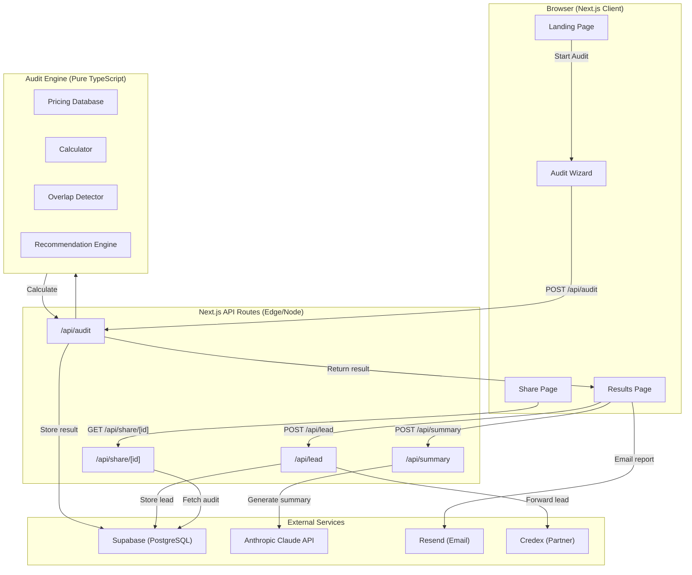
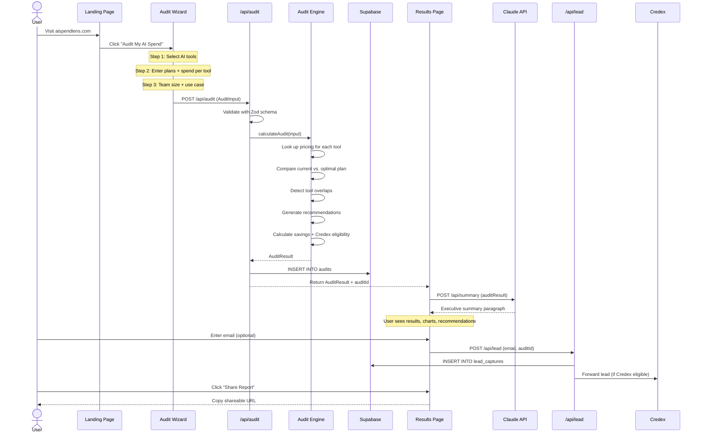
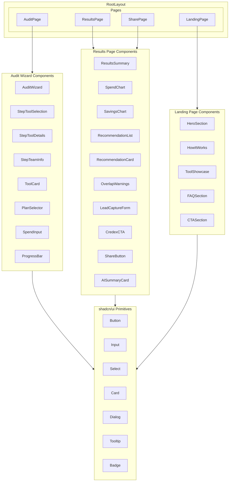
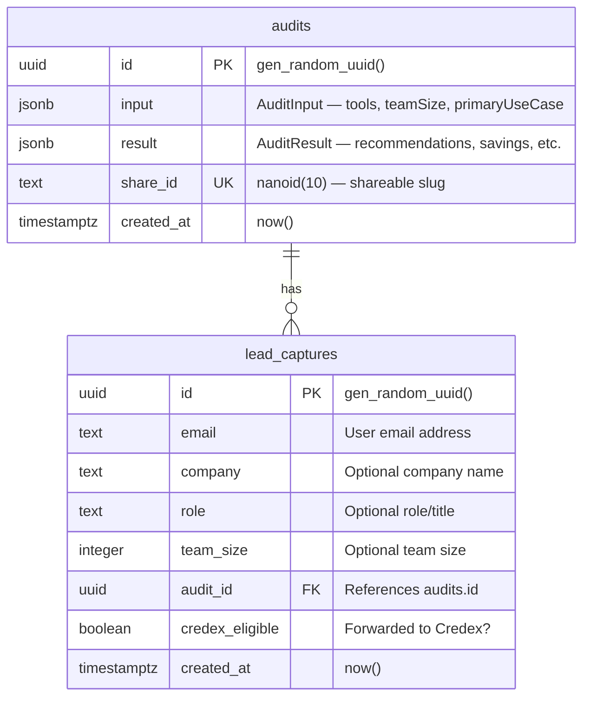
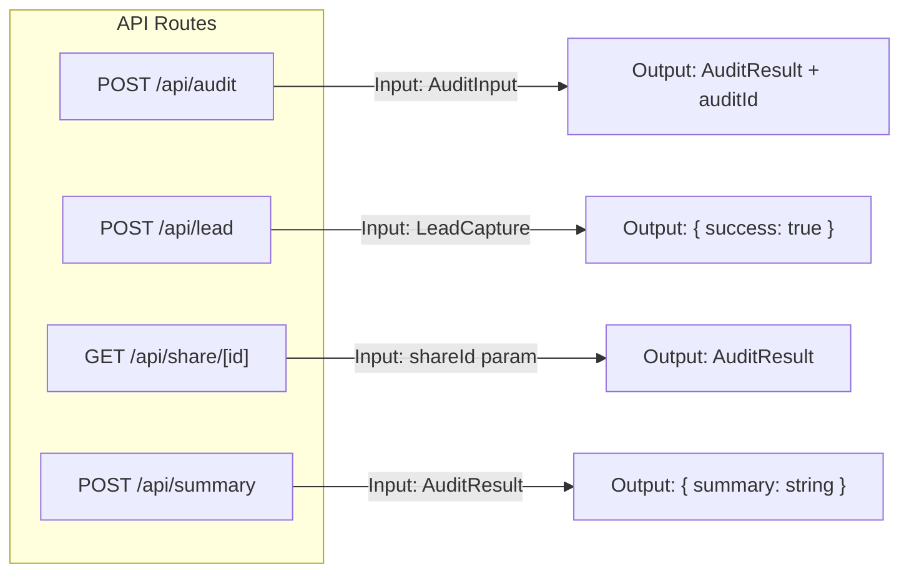
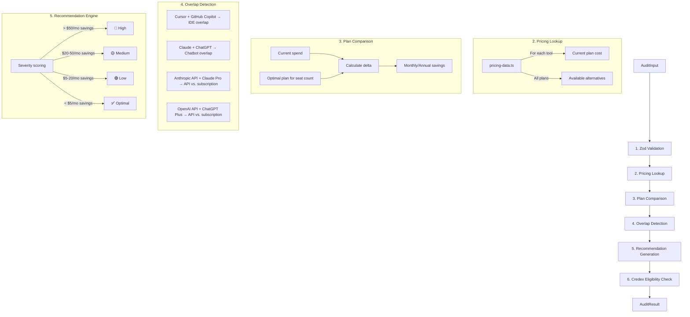
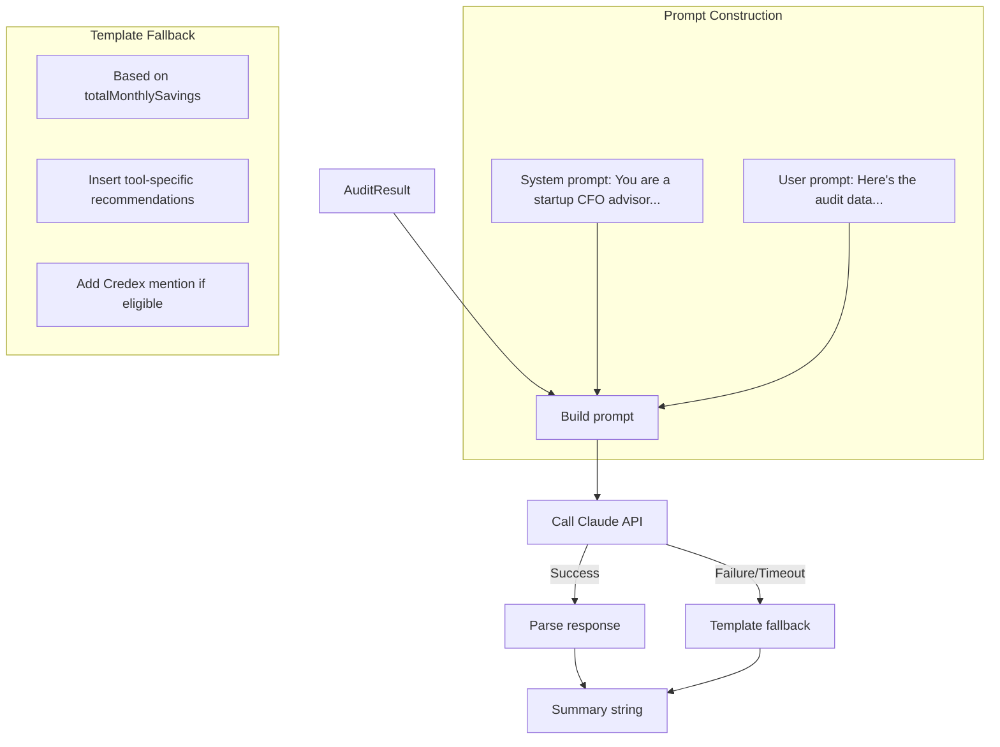
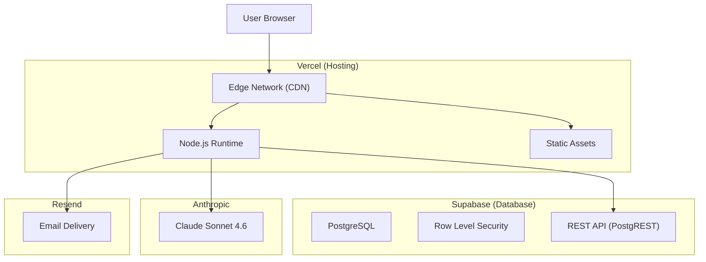

# Architecture

> System architecture for AISpendLens — an AI spend audit tool for startups.

---

## Table of Contents

- [High-Level Overview](#high-level-overview)
- [Request Flow](#request-flow)
- [Component Hierarchy](#component-hierarchy)
- [Data Model](#data-model)
- [API Route Map](#api-route-map)
- [Audit Engine Pipeline](#audit-engine-pipeline)
- [AI Summary Pipeline](#ai-summary-pipeline)
- [Infrastructure](#infrastructure)
- [Key Design Decisions](#key-design-decisions)

---

## High-Level Overview



---

## Request Flow

This is the complete user journey from landing to conversion:



---

## Component Hierarchy



---

## Data Model



### SQL Schema

```sql
-- audits table
CREATE TABLE audits (
    id          UUID DEFAULT gen_random_uuid() PRIMARY KEY,
    input       JSONB NOT NULL,
    result      JSONB NOT NULL,
    share_id    TEXT UNIQUE NOT NULL,
    created_at  TIMESTAMPTZ DEFAULT now() NOT NULL
);

CREATE INDEX idx_audits_share_id ON audits(share_id);
CREATE INDEX idx_audits_created_at ON audits(created_at DESC);

-- lead_captures table
CREATE TABLE lead_captures (
    id              UUID DEFAULT gen_random_uuid() PRIMARY KEY,
    email           TEXT NOT NULL,
    company         TEXT,
    role            TEXT,
    team_size       INTEGER,
    audit_id        UUID REFERENCES audits(id) ON DELETE CASCADE,
    credex_eligible BOOLEAN DEFAULT false,
    created_at      TIMESTAMPTZ DEFAULT now() NOT NULL
);

CREATE INDEX idx_lead_captures_email ON lead_captures(email);
CREATE INDEX idx_lead_captures_audit_id ON lead_captures(audit_id);

-- Row Level Security
ALTER TABLE audits ENABLE ROW LEVEL SECURITY;
ALTER TABLE lead_captures ENABLE ROW LEVEL SECURITY;

-- Public can read audits by share_id (for shared reports)
CREATE POLICY "Public can read shared audits"
    ON audits FOR SELECT
    USING (share_id IS NOT NULL);

-- Only service role can insert (API routes use service role key)
CREATE POLICY "Service role can insert audits"
    ON audits FOR INSERT
    WITH CHECK (true);

CREATE POLICY "Service role can insert leads"
    ON lead_captures FOR INSERT
    WITH CHECK (true);
```

---

## API Route Map



### Route Details

| Route | Method | Auth | Rate Limit | Description |
|-------|--------|------|------------|-------------|
| `/api/audit` | POST | None | 10/hr/IP | Run audit calculation, store result, return recommendations |
| `/api/lead` | POST | None | 5/hr/IP | Capture email + optional info, forward to Credex if eligible |
| `/api/share/[id]` | GET | None | 30/hr/IP | Retrieve a shared audit by `share_id` |
| `/api/summary` | POST | None | 10/hr/IP | Generate AI executive summary via Claude |

### Request/Response Schemas

**POST /api/audit**
```typescript
// Request body
{
  tools: Array<{
    tool: "cursor" | "github_copilot" | "claude" | "chatgpt" | "anthropic_api" | "openai_api" | "gemini" | "windsurf",
    plan: string,
    monthlySpend: number,
    seatCount: number
  }>,
  teamSize: number,
  primaryUseCase: "coding" | "writing" | "data" | "research" | "mixed"
}

// Response
{
  id: string,
  totalCurrentSpend: number,
  totalRecommendedSpend: number,
  totalMonthlySavings: number,
  totalAnnualSavings: number,
  recommendations: ToolRecommendation[],
  credexEligible: boolean,
  credexEstimatedSavings: number,
  overlapWarnings: string[],
  shareId: string
}
```

---

## Audit Engine Pipeline

The audit engine is the core of AISpendLens. It's a pure, deterministic TypeScript pipeline — no AI involved in the actual calculations. This is intentional: calculations must be reproducible and debuggable.



### Pipeline Steps in Detail

#### 1. Input Validation
Zod schemas validate all input. Rejects malformed data before any calculation begins. This runs both client-side (for instant feedback) and server-side (for security).

#### 2. Pricing Lookup
Each tool's current plan is matched against our pricing database (`pricing-data.ts`). The database stores official pricing with source URLs and verification dates. Updated manually — we check pricing pages weekly.

#### 3. Plan Comparison
For each tool, we calculate the optimal plan based on:
- **Seat count**: Some plans have per-seat pricing; others are flat
- **Feature needs**: Based on `primaryUseCase`
- **Volume**: API tools compare actual usage vs. subscription break-even

#### 4. Overlap Detection
The engine detects common overlap patterns:
- Using both Cursor Pro AND GitHub Copilot (IDE autocomplete overlap)
- Using both Claude Pro AND ChatGPT Plus (chatbot overlap)
- Paying for Claude Pro subscription AND heavy Anthropic API usage
- Paying for ChatGPT Plus AND heavy OpenAI API usage

#### 5. Recommendation Generation
Each tool gets a recommendation with:
- **Severity**: How much money is being wasted
- **Specific action**: "Downgrade from Pro to Free" or "Consolidate with X"
- **Reasoning**: Human-readable explanation
- **Alternative tool**: If consolidation is recommended

#### 6. Credex Eligibility
If `totalAnnualSavings > $1,000`, the user is flagged as Credex-eligible. This threshold is configurable via `CREDEX_SAVINGS_THRESHOLD`.

---

## AI Summary Pipeline

The AI summary is the only non-deterministic part of the system. It runs separately from the audit calculation and fails gracefully.



### Fallback Strategy

If Claude is unavailable or returns an error:
1. A template-based summary is generated using the structured audit data
2. The summary includes the top 3 recommendations by savings amount
3. No degradation in audit accuracy — only the narrative summary is affected

---

## Infrastructure



### Cost Profile (at scale)

| Service | Free Tier | Expected Cost at 1K audits/day |
|---------|-----------|-------------------------------|
| Vercel | 100GB bandwidth | ~$20/mo (Pro) |
| Supabase | 500MB DB, 2GB transfer | ~$25/mo (Pro) |
| Anthropic | None | ~$15/mo (~500 summaries/day × ~800 tokens × $3/MTok) |
| Resend | 100 emails/day | ~$20/mo (Pro) |
| **Total** | | **~$80/mo** |

---

## Key Design Decisions

### 1. No Authentication Required
We deliberately skipped auth. The goal is zero-friction: land → audit → value. Adding a login wall would kill conversion. Email is captured *after* the user sees their savings — classic value-first pattern.

### 2. Deterministic Audit Engine
The core audit logic is pure TypeScript with no AI dependency. This means:
- Results are reproducible and testable
- No API costs for the calculation itself
- Works offline (except for the summary)
- Audits complete in <100ms

### 3. Claude for Summary Only
AI is used only for generating the executive summary paragraph. This is the right trade-off:
- Calculations must be exact → deterministic code
- Summaries benefit from natural language → LLM
- If Claude is down, we fall back to templates → no degradation

### 4. Edge-Compatible API Routes
All API routes are designed to run on Vercel's Edge Runtime where possible, minimizing cold start latency. The `/api/summary` route uses Node.js runtime since the Anthropic SDK requires it.

### 5. Share via ID, Not Auth
Shared reports use a `nanoid(10)` slug. No auth required to view. This makes sharing frictionless but means reports are technically public if you guess the ID. The 10-character nanoid gives us ~1 trillion possibilities — acceptable for non-sensitive data.
